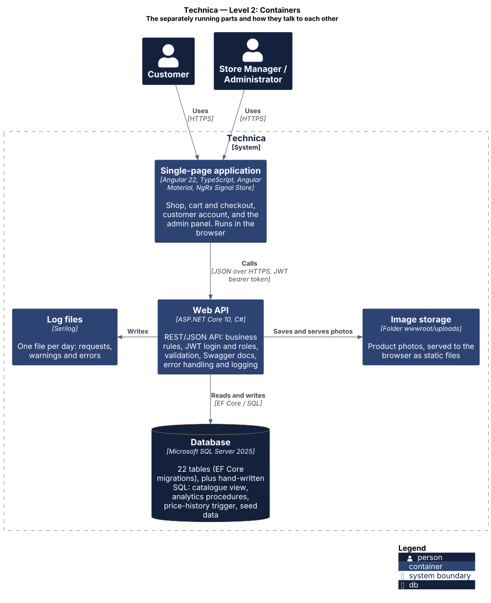

# OneStep

OneStep is a full-stack online electronics store, built as an IT Step Academy diploma project (project #2, e-commerce platform). Customers find products with search and filters, buy them through a cart and checkout with automatic delivery and VAT, pay (test mode) and track their orders. Store managers and administrators run the catalogue, stock, orders, campaigns, users and sales analytics from an admin panel.



## Contents

- [Features](#features)
- [Tech stack](#tech-stack)
- [Architecture](#architecture)
- [Getting started](#getting-started)
- [Demo accounts](#demo-accounts)
- [Database](#database)
- [API](#api)
- [Tests](#tests)
- [Git workflow](#git-workflow)
- [Possible improvements](#possible-improvements)

## Features

### Customers

- **Catalogue:** categories with subcategories, text search, filters (price range, brand, category, attributes such as colour or storage), sorting and paging. Filters live in the URL, so a filtered page can be bookmarked or shared.
- **Product page:** photo gallery, specifications, campaign price, stock status, similar products.
- **Cart:** add, change quantity (limited to the stock), remove. Prices always come from the server.
- **Checkout:** choose an address (or add one), a delivery method and a payment method. Totals are calculated by the API: discounts, delivery (free above a threshold) and 18% VAT.
- **Payment:** card payment in test mode (no real money), or cash on delivery.
- **Orders:** order history and a tracking page (Placed → Paid → Shipped → Delivered), with the full status history. Pending orders can be cancelled; their stock goes back.
- **Wishlist:** a heart on every product.
- **Reviews:** 1–5 stars with a title and text. Only customers who received the product can review it, once ("verified purchase").
- **Account:** profile, password change, address book with a default address.

### Store managers and administrators

- **Dashboard:** revenue, orders, average order value and new customers for 7, 30 or 90 days; revenue-per-day chart; best sellers; low-stock list; alerts. Numbers come from SQL Server stored procedures.
- **Alerts:** low stock, out of stock and new orders, checked every minute.
- **Products:** create, edit, hide or delete; specifications; several photos with a main photo; stock edited right in the list.
- **Orders:** search and filter all orders; move an order to its next status (the API refuses illegal moves, e.g. Delivered → Pending).
- **Campaigns:** discounts with a start and end date (scheduled activation), shown with their state; switch one off or on.
- **Users (administrators only):** change roles, block or unblock accounts.

### Cross-cutting

- JWT authentication, three roles (Customer, StoreManager, Admin) and role-based policies on every endpoint.
- Swagger / OpenAPI documentation with an "Authorize" button.
- Global error handling: every error is returned as a standard `ProblemDetails` JSON response with the right status code (400, 401, 403, 404, 409).
- Logging with Serilog to the console and to a daily log file.
- Responsive design from 360 px phones to wide desktops.

## Tech stack

| Layer | Technology |
| --- | --- |
| Frontend | Angular 22 (standalone components, signals, zoneless), TypeScript, Angular Material, NgRx Signal Store, SCSS |
| Backend | ASP.NET Core 10 Web API, C#, clean architecture |
| Data access | Entity Framework Core 10, code-first with migrations |
| Database | Microsoft SQL Server 2025, plus hand-written SQL (view, stored procedures, trigger, seed data) |
| Auth | JWT bearer tokens, PBKDF2 password hashing (ASP.NET Core Identity hasher) |
| Docs | Swagger UI, C4 model diagrams (PlantUML) |
| Tests | xUnit |

## Architecture

The diagrams follow the [C4 model](https://c4model.com). Sources (`.puml`), images and one PDF with everything are in [`docs/architecture`](docs/architecture).

| Level | Diagram |
| --- | --- |
| 1. System context | [c4-1-system-context.png](docs/architecture/c4-1-system-context.png) |
| 2. Containers | [c4-2-containers.png](docs/architecture/c4-2-containers.png) |
| 3. Components (API) | [c4-3-components-api.png](docs/architecture/c4-3-components-api.png) |
| 3. Components (Angular) | [c4-3-components-spa.png](docs/architecture/c4-3-components-spa.png) |
| 4. Code (checkout and orders) | [c4-4-code-checkout.png](docs/architecture/c4-4-code-checkout.png) |
| Database design | [database-er.png](docs/architecture/database-er.png) |

### Backend: clean architecture

```
OneStep.Api             HTTP layer: controllers, middleware, Swagger, startup (Program.cs)
   ↓
OneStep.Application     use cases: services, DTOs with validation, business rules, interfaces
   ↓
OneStep.Domain          entities, enums, the order state machine — no dependencies

OneStep.Infrastructure  implements Application's interfaces: EF Core DbContext, stored-procedure
                        queries, JWT tokens, password hashing, file storage
```

Dependencies point inward. Application defines interfaces such as `IAppDbContext`, `ITokenService` and `IFileStorage`; Infrastructure implements them, and dependency injection connects the two. Business rules that need no database (checkout totals, discounts, status transitions, review rules) are pure functions with unit tests.

### Frontend

```
src/app/
├─ core/        app-wide: models, API services, stores, interceptors, guards, layout
├─ shared/ui/   reusable components: product card, price tag, rating stars, wishlist heart…
└─ features/    lazy-loaded pages: home, catalog, cart, checkout, account, auth, admin
```

State management uses **NgRx Signal Store**: global stores for the logged-in user, the cart, the wishlist and the category tree, and a store scoped to the admin panel for alerts. Page-only state stays in the page as signals; filter state lives in the URL.

## Getting started

### Prerequisites

- [.NET 10 SDK](https://dotnet.microsoft.com/download)
- SQL Server 2025 (Developer edition) and SQL Server Management Studio (SSMS)
- [Node.js](https://nodejs.org) 24 or newer
- Angular CLI 22: `npm install -g @angular/cli@22`
- EF Core tools: `dotnet tool install --global dotnet-ef --version 10.*`

### 1. Get the code

```powershell
git clone https://github.com/Khutsuna/OneStep.git
cd OneStep
```

### 2. Check the connection string

`backend/src/OneStep.Api/appsettings.Development.json` uses the local default SQL Server instance with Windows authentication:

```json
"ConnectionStrings": {
  "Default": "Server=localhost;Database=OneStep;Trusted_Connection=True;TrustServerCertificate=True;MultipleActiveResultSets=true"
}
```

If your SQL Server is a named instance, change `Server=localhost` (for example to `Server=localhost\SQLEXPRESS`).

### 3. Set the JWT signing key

The key that signs login tokens is a secret, so it is not in the repository. Store it with .NET user-secrets (in PowerShell, from the `backend` folder):

```powershell
cd backend
$bytes = New-Object byte[] 48
[Security.Cryptography.RandomNumberGenerator]::Create().GetBytes($bytes)
$key = [Convert]::ToBase64String($bytes)
dotnet user-secrets set "Jwt:Key" $key --project src/OneStep.Api
```

### 4. Create the database

EF Core creates the tables; the SQL scripts add the parts written by hand.

```powershell
# still in the backend folder
dotnet ef database update --project src/OneStep.Infrastructure --startup-project src/OneStep.Api
```

Then open SSMS, connect to your server, and run these files from the `database` folder **in this order** (File → Open → File…, then F5):

| Script | What it does |
| --- | --- |
| `03_views.sql` | `vw_ProductCatalog`, the view the product search runs on |
| `04_procedures.sql` | sales analytics stored procedures for the dashboard |
| `05_triggers.sql` | `trg_Products_PriceHistory`, records every price change |
| `06_seed.sql` | demo data: users, 40 products, campaigns, 60 orders, reviews |
| `07_demo_price_history.sql` | a few past price changes, so the price chart on the product page has data |

Prefer pure SQL? Run `01_create_database.sql` and `02_schema.sql` (generated from the migrations) instead of `dotnet ef database update`, then the five scripts above.

### 5. Run the API

```powershell
cd backend
dotnet run --project src/OneStep.Api
```

- API: http://localhost:5091
- Swagger UI: http://localhost:5091/swagger
- Health check: http://localhost:5091/health

### 6. Run the website (in a second terminal)

```powershell
cd frontend
npm install
ng serve
```

Open http://localhost:4200.

## Demo accounts

Created by `06_seed.sql`:

| Role | Email | Password |
| --- | --- | --- |
| Administrator | admin@onestep.ge | Admin123! |
| Store manager | manager@onestep.ge | Manager123! |
| Customer | nino.beridze@example.com | Customer123! |

Seven more customers (for example `luka.gelashvili@example.com`) use the password `Customer123!`. Passwords are stored only as PBKDF2 hashes.

The seed data includes products on low stock and one out of stock, an inactive product, and campaigns that are ended, running and scheduled, so every feature has something to show.

## Database

22 tables, designed in third normal form with deliberate exceptions. Full diagram: [database-er.png](docs/architecture/database-er.png).

- **Keys and constraints:** every table has a primary key; link tables (`CampaignProducts`, `CampaignCategories`, `ProductAttributeValues`, `WishlistItems`) use composite keys. Unique indexes protect e-mails, SKUs, slugs and "one review per customer per product". CHECK constraints protect prices, stock (never below 0), ratings (1–5), campaign dates and order totals.
- **Filtered unique indexes:** at most one main photo per product and one default address per customer.
- **Snapshots (deliberate denormalisation):** order lines copy the product name, SKU and price, and orders copy the delivery address, so old orders never change when a product or address changes.
- **Soft delete:** deleted products keep their row (old orders point to them) and are hidden by an EF Core query filter.
- **Concurrency:** `Products.RowVersion` stops two customers from buying the last item at the same time; the second checkout gets a 409.
- **Computed column:** `OrderItems.LineTotal` is calculated and stored by SQL Server.

Hand-written SQL in [`database/`](database):

| Object | Type | Purpose |
| --- | --- | --- |
| `vw_ProductCatalog` | view | products with category, brand, main photo and rating; mapped as a read-only EF entity and used by the product search |
| `usp_GetDashboardSummary` | stored procedure | revenue, order counts, new customers, items needing attention |
| `usp_GetSalesByDay` | stored procedure | revenue per day for the sales chart |
| `usp_GetTopProducts` | stored procedure | best sellers by revenue |
| `trg_Products_PriceHistory` | trigger | writes every price change to `ProductPriceHistory` |

## API

REST over JSON. Interactive documentation: http://localhost:5091/swagger (log in with `POST /api/auth/login`, then click **Authorize** and paste the token).

| Area | Endpoints | Access |
| --- | --- | --- |
| Auth | `POST /api/auth/register`, `POST /api/auth/login`, `GET /api/auth/me` | public / logged in |
| Products | `GET /api/products` (search, filters, paging), `GET /api/products/{id}`, `GET /api/products/filters`, `GET /api/products/{id}/similar` | public |
| Product management | `POST/PUT/DELETE /api/products…`, `PATCH /api/products/{id}/stock`, `POST/PUT/DELETE /api/products/{id}/images…`, `GET /api/products/low-stock` | staff |
| Categories, brands, attributes | `GET /api/categories`, `/api/brands`, `/api/attributes`; create/edit/delete | public / staff |
| Delivery methods | `GET /api/delivery-methods` | public |
| Cart | `GET/DELETE /api/cart`, `POST /api/cart/items`, `PUT /api/cart/items/{id}/quantity`, `DELETE /api/cart/items/{id}` | customer |
| Orders | `POST /api/orders/quote`, `POST /api/orders`, `GET /api/orders`, `GET /api/orders/{id}`, `POST /api/orders/{id}/pay`, `POST /api/orders/{id}/cancel` | customer (own orders) / staff |
| Order status | `PUT /api/orders/{id}/status` | staff |
| Account | `GET/PUT /api/account/profile`, `PUT /api/account/password` | logged in |
| Address book | `GET/POST /api/account/addresses`, `PUT/DELETE /api/account/addresses/{id}`, `PUT /api/account/addresses/{id}/default` | customer |
| Wishlist | `GET /api/account/wishlist`, `GET /api/account/wishlist/ids`, `PUT/DELETE /api/account/wishlist/{productId}` | customer |
| Reviews | `GET /api/products/{id}/reviews`, `POST /api/products/{id}/reviews`, `DELETE /api/reviews/{id}` | public / customer / owner or staff |
| Analytics | `GET /api/analytics/dashboard?days=30` | staff |
| Notifications | `GET /api/notifications`, `PUT /api/notifications/{id}/read`, `PUT /api/notifications/read-all` | staff |
| Campaigns | `GET /api/campaigns`, `PUT /api/campaigns/{id}/enabled` | staff |
| Users | `GET /api/users`, `PUT /api/users/{id}`, `GET /api/users/{id}/orders` | admin |

Errors use the standard [ProblemDetails](https://www.rfc-editor.org/rfc/rfc9457) format, for example:

```json
{ "status": 409, "title": "Conflict", "detail": "An order can't go from Delivered to Pending." }
```

## Tests

```powershell
cd backend
dotnet test
```

38 xUnit tests cover the core business rules: checkout totals (delivery, free-delivery threshold, 18% VAT, rounding), campaign discounts, the order status state machine, campaign states, analytics day-filling and the review rules.

## Git workflow

GitHub Flow: `main` is protected and always works. Each milestone was built on its own branch (`feature/c5-cart-checkout`, `feature/c6-admin-panel`, …) and merged through a pull request. Commit messages follow [Conventional Commits](https://www.conventionalcommits.org) (`feat(orders): …`, `fix(api): …`, `docs: …`).

## Possible improvements

- Real card payments with Stripe (the payment step is already a separate endpoint).
- Order confirmation e-mails and password reset by e-mail (the `PasswordResetTokens` table is ready).
- Cloud image storage (Azure Blob Storage or Amazon S3): only a new `IFileStorage` implementation is needed.
- Campaign create/edit form, and a delivery-method editor.
- Personalised recommendations based on order history.
- Integration tests against a test database, and a CI pipeline (GitHub Actions) that runs the tests on every pull request.
- Docker Compose to start SQL Server, the API and the website with one command.

## Author

Gio — IT Step Academy, Tbilisi, 2026
